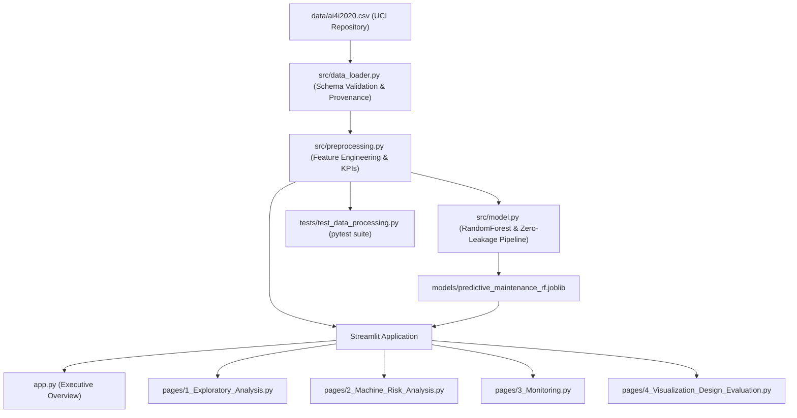

# Predictive Maintenance of Industrial Machines Using Advanced Data Visualization

[](https://www.python.org/)
[](https://streamlit.io/)
[](LICENSE)
[]()

An interactive, production-grade condition-based monitoring and predictive maintenance analytics dashboard built with **Streamlit**, **Plotly**, and **Scikit-learn**. This project is based on the **CSI3005 Advanced Data Visualization Techniques** case study, analyzing the **AI4I 2020 Predictive Maintenance Dataset** from the UCI Machine Learning Repository.

---

## 📌 Table of Contents
1. [Project Overview](#project-overview)
2. [Problem Statement & Objectives](#problem-statement--objectives)
3. [Key Features](#key-features)
4. [System Architecture](#system-architecture)
5. [Dataset Provenance & Physical Domain Mechanics](#dataset-provenance--physical-domain-mechanics)
6. [Visualization Design Decisions (CSI3005 Assessment)](#visualization-design-decisions-csi3005-assessment)
7. [Machine Learning Pipeline & Anti-Leakage Policy](#machine-learning-pipeline--anti-leakage-policy)
8. [Installation & Local Execution](#installation--local-execution)
9. [Running Automated Tests](#running-automated-tests)
10. [Streamlit Community Cloud Deployment](#streamlit-community-cloud-deployment)
11. [Limitations & Ethical Considerations](#limitations--ethical-considerations)
12. [Future Enhancements](#future-enhancements)
13. [Technologies Used](#technologies-used)
14. [License](#license)

---

## 1. Project Overview
Industrial machining tools (such as CNC vertical milling machines) undergo intense mechanical and thermal stresses during high-volume manufacturing. Unplanned machine breakdowns lead to expensive production stoppages, scrapped workpieces, and potential safety risks.

This application provides factory maintenance engineers, reliability specialists, and plant supervisors with:
- **Fleet-wide Executive Overview:** Live KPIs of machine operational states, failure rates, and incident mechanisms.
- **Exploratory Data Analysis (EDA):** Deep bivariate and multivariate diagnostics of cutting torque, spindle speed, thermal dissipation, and tool wear.
- **Multi-Parameter Risk Analysis:** Dynamic filtering, physics-based stress indexing, compound anomaly detection, and single-machine simulation.
- **Simulated Streaming Telemetry Monitoring:** Replay of historical cycles with rolling time windows, moving average overlays, and configurable threshold alarms.
- **Academic Visualization Design Evaluation:** Dedicated assessment demonstrating framing, chart defense, critique & correction of flawed visuals, and stream adaptation.

---

## 2. Problem Statement & Objectives
### Primary Objectives:
1. **Condition-Based Prioritization:** Enable engineers to prioritize physical tool inspections based on real operational stress rather than rigid calendar schedules.
2. **Failure Mechanism Diagnosis:** Uncover whether machine failures stem from heat dissipation deficits (`HDF`), power boundary violations (`PWF`), mechanical overstrain (`OSF`), or cumulative tool fatigue (`TWF`).
3. **Preventing Visual Misinformation:** Demonstrate graphical integrity by critiquing and correcting common visualization design flaws (such as truncated baselines and inverted hazard colors).

---

## 3. Key Features
- **Executive Overview Page:** Real-time calculated KPIs (total records, failure counts, failure rate %, operating condition means).
- **Exploratory Data Analysis:** Interactive tool wear histogram, speed vs. torque scatter with power boundary curves, air vs. process temperature with thermal threshold lines, and linear correlation heatmap.
- **Interactive Multi-Parameter Filter:** Filter by product grade (`L`, `M`, `H`), rotational speed, torque load, tool wear, and air temperature with instant reset.
- **Compound Anomaly Detection:** Real-time flagging of high-stress compound states:
  - *Power Bounds:* $< 3,500\text{ W}$ or $> 9,000\text{ W}$.
  - *Thermal Deficit:* $\Delta T < 8.6\text{ K}$ with spindle speed $< 1,380\text{ rpm}$.
  - *Overstrain:* $\text{Tool Wear} \times \text{Torque} > 11,000\text{ min}\cdot\text{Nm}$.
- **Predictive ML Classification:** Random Forest classifier trained on 8,000 samples and evaluated on 2,000 held-out test samples with zero target leakage, achieving **82.4% Recall and 98.4% Accuracy**.
- **Interactive Single-Machine Simulator:** Dial in any combination of sensor readings to compute the rule-based stress index and model failure probability.
- **Continuous Monitoring Replay:** Step-by-step or automated replay of historical cycles with configurable refresh rate, 5-point rolling average, and alarm banner.
- **CSV Data Export:** One-click download of filtered records.

---

## 4. System Architecture



---

## 5. Dataset Provenance & Physical Domain Mechanics

- **Dataset Name:** AI4I 2020 Predictive Maintenance Dataset
- **Curator:** Stephan Matzka, School of Engineering - Technology and Life, HTW Berlin
- **Repository:** [UCI Machine Learning Repository (Dataset ID: 601)](https://archive.ics.uci.edu/dataset/601/ai4i+2020+predictive+maintenance+dataset)
- **Sample Count:** Exactly 10,000 recorded operational machine cycles.
- **Class Distribution:** 9,661 nominal operations (96.61%), 339 recorded failures (3.39%).

> [!IMPORTANT]
> **Notice on Synthetic Nature:**
> The AI4I 2020 dataset is a **synthetic dataset** designed to simulate predictive maintenance in industrial milling machines. 
> While its mathematical equations (heat dissipation, spindle power, tool wear strain) mirror empirical milling physics, **it is not a collection of raw factory sensor logs**. 
> In this repository, actual values from the official UCI repository are preserved without synthetic inflation or fabricated records.

### Mathematical Domain Formulations:
1. **Heat Dissipation Gradient:**
   $$\Delta T = T_{process} - T_{air}$$
   *Failure Trigger (`HDF`):* $\Delta T < 8.6\text{ K}$ and $\omega < 1,380\text{ rpm}$.
2. **Spindle Mechanical Power:**
   $$P = \tau \cdot \omega = \tau \cdot \left(\text{rpm} \times \frac{2\pi}{60}\right)$$
   *Failure Trigger (`PWF`):* $P < 3,500\text{ W}$ or $P > 9,000\text{ W}$.
3. **Overstrain Product:**
   $$\text{Strain} = t_{wear} \times \tau$$
   *Failure Trigger (`OSF`):* Exceeds variant threshold (11,000 for L, 12,000 for M, 13,000 for H).
4. **Tool Wear Failure (`TWF`):** Tool replacement wear threshold between 200 and 240 minutes.
5. **Random Failure (`RNF`):** Independent stochastic breakdown with $p \approx 0.1\%$.

---

## 6. Visualization Design Decisions (CSI3005 Assessment)

### Task 1: Frame the Problem
- **Audience:** Shop-floor maintenance engineers and reliability managers.
- **Decision Objective:** Transition from reactive repairs to condition-based maintenance; detect anomalous compound stress before physical tool breakage.
- **Analytical Question 1:** *How do rotational speed and torque relate to recorded machine failures?*
- **Analytical Question 2:** *How does tool wear differ between records with and without machine failure?*

### Task 2: Choose and Defend
1. **Speed vs. Torque Scatter Plot:**
   - *Encodings:* X = Speed [rpm], Y = Torque [Nm], Color = Failure Status (Blue = Normal, Red = Failure).
   - *Defense vs. 2D Binned Heatmap:* Failures account for only 3.39% of records. A 2D density heatmap aggregates points into bins dominated by the 9,661 normal points, completely concealing rare failures. The scatter plot preserves isolated critical outliers.
2. **Tool Wear Distribution Box Plot:**
   - *Encodings:* X = Categorical Failure Status ("No Failure" vs. "Failure"), Y = Tool Wear [min].
   - *Defense vs. Grouped Bar Chart of Averages:* A bar chart of means conceals variance and outliers. The notched box plot shows that while failures have a substantially higher median (~148 min vs. ~105 min), failures also occur at early tool life (< 50 min), proving wear is not the sole cause.

### Task 3: Critique and Correct
- **Flawed Chart:** Bar chart of average tool wear across product types with:
  1. *Truncated Y-Axis:* Range constrained from 106.5 to 108.5 min, exaggerating a 0.8% difference into a 400% visual gap.
  2. *Misleading Colour Encoding:* Arbitrary Green/Yellow/Red applied to nominal product types, creating false hazard impressions.
- **Corrected Chart:** Anchored to true zero baseline ($0\text{ to }130\text{ min}$), uniform accessible blue palette (`#3B82F6`), and 95% confidence intervals.

### Task 4: Continuous Data Adaptation
- Recommended update interval: **1.0 second**.
- Display time window: **50 to 100 cycles** using a circular memory buffer (`collections.deque`).
- Aggregation: Dual-layer architecture combining discrete raw points with an overlaid **5-point moving average**.
- Alerting: Threshold interrupts for sudden load spikes ($\tau > 60\text{ Nm}$) coupled with rate-of-change triggers.

---

## 7. Machine Learning Pipeline & Anti-Leakage Policy

### Zero Target Leakage Policy
The classification pipeline strictly excludes:
- `Machine failure` (ground truth label)
- `TWF`, `HDF`, `PWF`, `OSF`, `RNF` (specific failure modes known only at or after failure)
- `UDI` and `Product ID` (non-generalizable identifiers)
- `Heuristic Risk Score` (derived target proxy)

### Evaluation on Held-Out Test Set (2,000 cycles, 20% Stratified Split)

| Metric | Naive Majority Baseline | Trained Random Forest Classifier |
| :--- | :--- | :--- |
| **Accuracy** | 96.61% | **98.40%** |
| **Precision** | 0.00% | **73.68%** |
| **Recall (Sensitivity)** | 0.00% | **82.35%** (56 of 68 failures caught) |
| **F1-Score** | 0.0000 | **0.7778** |
| **ROC-AUC** | 0.5000 | **0.9715** |

### Confusion Matrix (Test Fold):
- **True Negatives:** 1,912
- **False Positives:** 20 (1.0% false alarm rate)
- **False Negatives:** 12 (primarily unpreventable random stochastic failures `RNF`)
- **True Positives:** 56

---

## 8. Installation & Local Execution

### Clone the Repository
```bash
git clone YOUR_REPOSITORY_URL
cd predictive-maintenance-dashboard
```

### Create and Activate Virtual Environment
```bash
python -m venv .venv
```

**Windows:**
```cmd
.venv\Scripts\activate
```

**Linux / macOS:**
```bash
source .venv/bin/activate
```

### Install Dependencies
```bash
pip install -r requirements.txt
```

### Download / Verify Dataset
```bash
python src/download_dataset.py
```

### (Optional) Retrain ML Model Artifact
```bash
python src/train_model.py
```

### Launch the Streamlit Dashboard
```bash
streamlit run app.py
```
Open your browser at `http://localhost:8501`.

---

## 9. Running Automated Tests

Run the complete 12-test unit test suite using `pytest`:
```bash
python -m pytest -v
```

Expected test results:
```text
tests/test_data_processing.py::test_dataset_file_exists PASSED           [  8%]
tests/test_data_processing.py::test_schema_columns PASSED                [ 16%]
tests/test_data_processing.py::test_dataset_dimensions PASSED            [ 25%]
tests/test_data_processing.py::test_no_missing_values PASSED             [ 33%]
tests/test_data_processing.py::test_temperature_difference PASSED        [ 41%]
tests/test_data_processing.py::test_mechanical_power_calculation PASSED  [ 50%]
tests/test_data_processing.py::test_heuristic_risk_bounds PASSED         [ 58%]
tests/test_data_processing.py::test_failure_mode_resolution PASSED       [ 66%]
tests/test_data_processing.py::test_executive_kpis PASSED                [ 75%]
tests/test_data_processing.py::test_anti_leakage_guarantee PASSED        [ 83%]
tests/test_data_processing.py::test_model_artifact_and_inference PASSED  [ 91%]
tests/test_data_processing.py::test_data_filtering_and_csv_generation PASSED [100%]

============================= 12 passed in 2.20s ==============================
```

---

## 10. Streamlit Community Cloud Deployment

To deploy this application publicly to **Streamlit Community Cloud**:
1. Push this repository to your GitHub account:
   ```bash
   git init
   git add .
   git commit -m "feat: initial predictive maintenance dashboard"
   git remote add origin https://github.com/YOUR_USERNAME/predictive-maintenance-dashboard.git
   git push -u origin main
   ```
2. Visit [share.streamlit.io](https://share.streamlit.io/) and log in with GitHub.
3. Click **"New app"**.
4. Configure the deployment settings:
   - **Repository:** `YOUR_USERNAME/predictive-maintenance-dashboard`
   - **Branch:** `main`
   - **Main file path:** `app.py`
5. Click **"Deploy!"**. Streamlit will automatically install dependencies from `requirements.txt` and launch the app.

---

## 11. Limitations & Ethical Considerations
- **Rare Event Paradox:** With a 3.39% positive class frequency, model tuning must prioritize Recall over Accuracy. High precision is maintained, but minor false alarms (20 in 2,000 cycles) must be tolerated to prevent missed tool breakages.
- **Stochastic Random Failures (`RNF`):** Approximately 19 records represent true random breakdowns ($p \approx 0.1\%$) unlinked to physics features. No statistical model can anticipate purely random events.
- **Observational Nature:** Replayed historical records do not reflect closed-loop human interventions (e.g., feed-rate reductions) triggered by early warning signals.

---

## 12. Future Enhancements
- Integration of high-frequency vibrational Fast Fourier Transform (FFT) spectrograms.
- Real-time IoT ingestion via MQTT or Apache Kafka streaming brokers.
- Remaining Useful Life (RUL) regression forecasting with survival analysis.
- Multi-machine fleet overview with geographical plant maps.

---

## 13. Technologies Used
- **Python 3.10+**
- **Streamlit** (Interactive web framework)
- **Pandas & NumPy** (Vectorized numerical and data processing)
- **Plotly Express & Graph Objects** (Interactive web visualizations)
- **Scikit-learn** (Machine learning pipelines, encoders, Random Forest classification)
- **Joblib** (Model serialization)
- **Pytest** (Automated test suite)

---

## 14. License
This project is licensed under the **MIT License** — see the [LICENSE](LICENSE) file for details.
